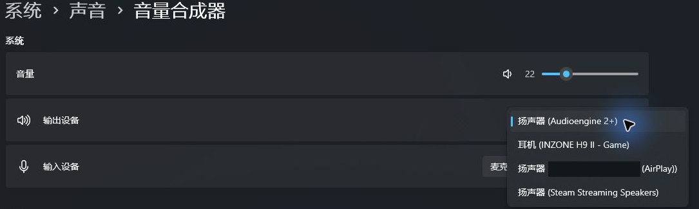

# WinAirPlayAudio

Use a compatible AirPlay speaker as a Windows sound output. WinAirPlayAudio
discovers receivers on your local network and gives each eligible receiver its
own playback device in Windows Settings and the volume mixer.

**Experimental · Windows 11 x64, 24H2 or newer · Classic AirPlay 1/RAOP only**

AirPlay 2 and pairing-required receivers are not supported. Physical playback
and clean-machine installation still need acceptance testing; this is a
prototype for controlled testing, not a production-certified driver.

> **Volume and mute:** Windows endpoint volume and mute do not yet control
> outgoing audio. Use the receiver's own controls; Windows mute cannot be relied
> on to silence remote playback.

## How it looks

**Settings → System → Sound** lists the receiver as an output ending in
**(AirPlay)**.

The **Volume mixer** also lists the receiver in its **Output device** menu.

These screenshots show an installed endpoint on a Chinese-language Windows 11
system. Receiver names are redacted.

## Get started

This source preview includes build and test instructions. Start with the
[development guide](docs/development.md), which includes a discovery test that
runs without installing the driver. Prebuilt installers are unavailable.

To evaluate audio routing, follow the [test-machine procedure](docs/build-and-install.md)
on a disposable Windows 11 x64 machine with recovery access. After setup,
choose the receiver ending in **(AirPlay)** under **Settings → System → Sound**
or in the [volume mixer](docs/usage.md#open-the-volume-mixer-from-the-taskbar).
Use the receiver’s own controls for volume and mute.

## Compatibility and help

- Receivers must support the implemented classic AirPlay profile; an AirPlay
  logo alone does not establish compatibility. See [receiver requirements](docs/usage.md#receiver-compatibility).
- AirPlay 2, PIN pairing, encrypted audio, ALAC, and multi-room playback are
  not implemented. Windows 10 and ARM64 are not validated.
- Network reliability, service privileges, long playback sessions and installed
  driver acceptance still have [known limitations](docs/known-limitations.md).

Start with the [usage guide](docs/usage.md),
[troubleshooting](docs/troubleshooting.md), or the
[documentation overview](docs/README.md). For bug reports, follow
[Contributing](CONTRIBUTING.md); report security issues through [SECURITY.md](SECURITY.md).
Remove personal details, receiver identifiers and credentials before sharing logs.

## Contributing

See [Contributing](CONTRIBUTING.md) and the [development guide](docs/development.md)
for building, discovery without driver installation, testing and project structure.
The [docs overview](docs/README.md) links to architecture, release procedures,
validation records and future plans.

## License

Copyright (c) 2026 WinAirPlayAudio contributors.

Original code, scripts and documentation outside the driver component use
[AGPL-3.0-only](LICENSE). The Microsoft-derived driver and its adaptations remain
under the [Microsoft Public License](driver/LICENSE.microsoft-samples.txt).
Third-party components retain their own licenses; see [third-party notices](THIRD_PARTY_NOTICES.md)
and the [licensing guide](docs/airplay-compatibility-and-licensing.md#project-licenses).
